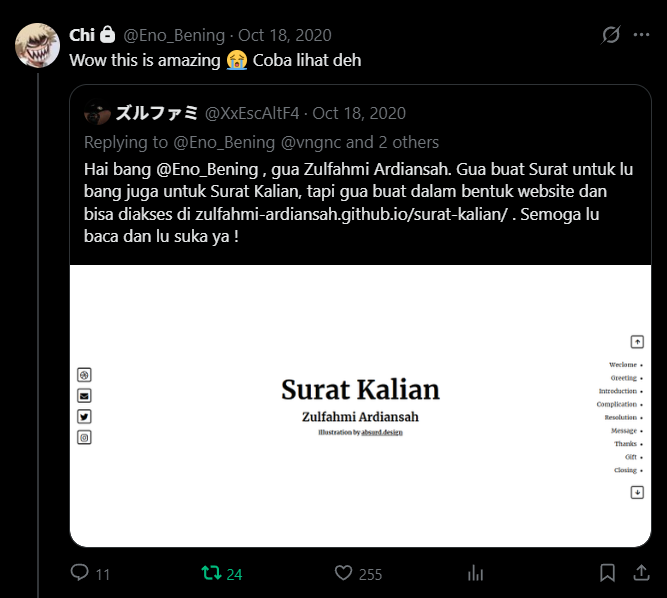

# Eno Bening - Portfolio Web

> A modern, responsive personal landing page and portfolio website for Eno Bening — Social Media Strategist & Content Consultant.


**Eno Bening Portfolio Web** showcases the personal brand, professional services, corporate clients, and recent writing of Eno Bening, a prominent Indonesian social media consultant with over a decade of experience. The site features dynamic article fetching from KaryaKarsa API, smooth scroll animations, and a fully responsive layout.

**Demo:** <https://zulfahmi-ardiansah.github.io/eno-bening/>

---

## Features

- **Hero & Profile Showcase**: Highlights Eno Bening's background, expertise, and featured brand collaborations.
- **Client Portfolio Grid**: Interactive logos showcasing brand partnerships across diverse industries.
- **Services Breakdown**: Clear overview of core consulting services including *Counsel & Advising*, *Brand Strategy*, and *Social Media Management*.
- **Dynamic KaryaKarsa Integration**: Live client-side fetch (`api.karyakarsa.com`) pulling recent posts, custom thumbnails, and localized publication dates.
- **Direct Contact & Social Links**: Easy-to-reach contact options including Email, Instagram, Twitter, and direct phone contact.
- **Scroll & Visual Animations**: Scroll-triggered element animations powered by AOS (Animate On Scroll) and Animate.css.
- **Responsive Web Design**: Optimized stylesheets (`style.css` & `mobile.css`) providing seamless experiences across desktop and mobile devices.

---

## How It Works & Project Structure

The project is built as a lightweight, high-performance static web application.

```
personal-eno-bening/
├── index.html          # Main HTML structure and section layouts
├── res/                # Web assets and resources
│   ├── css/
│   │   ├── style.css   # Main stylesheet (layout, typography, components)
│   │   └── mobile.css  # Mobile responsive overrides and media queries
│   ├── img/            # Brand logos, avatars, icons, and tweet screenshot
│   └── js/
│       └── script.js   # Dynamic KaryaKarsa API fetch & AOS initialization
├── tweet.png           # Tweet acknowledgement screenshot
├── .gitignore          # Git ignore configuration
└── README.md           # Project documentation
```

### Dynamic Article Pipeline

```
┌─────────────────┐       jQuery AJAX       ┌────────────────────────┐
│  index.html     │ ──────────────────────> │ api.karyakarsa.com API │
│ (#article-cont) │ <────────────────────── │ (posts/enobening)      │
└─────────────────┘     JSON Article Data   └────────────────────────┘
```

1. Upon page load, `script.js` initializes the AOS animation library.
2. An asynchronous HTTP request is sent to `https://api.karyakarsa.com/api/posts/enobening?page=1`.
3. The latest 3 articles are formatted with Indonesian date parsing and dynamically injected into `#article-content`.

---

## Getting Started

### Prerequisites

To view or host this project locally, you only need a modern web browser:
- **Web Browser**: Chrome, Firefox, Edge, Safari, or Opera.
- **Optional**: Local HTTP server (Python, Node.js `serve`, or VS Code Live Server extension).

### Installation & Setup

1. **Clone the repository**:
   ```bash
   git clone https://github.com/zulfahmi-ardiansah/eno-bening.git
   cd personal-eno-bening
   ```

2. **Run locally**:
   - **Directly**: Open `index.html` in your web browser.
   - **Using Python 3**:
     ```bash
     python -m http.server 8000
     ```
     Then open `http://localhost:8000` in your browser.

---

## Usage

Simply navigate through the single-page landing sections:
- **Home**: Overview & Client list.
- **Services**: Service cards detailing strategy and management offerings.
- **Articles**: Live feed of latest publications.
- **Contact**: Social media links and direct contact details.

---

## Acknowledgements

Special thanks to **Eno Bening** ([@Eno_Bening](https://x.com/Eno_Bening)) for reacting to and supporting the projects I created for him.

This repository is actually the **second repository** I built as a personal gift for Eno Bening. The initial project shown in the tweet screenshot—**"Surat Kalian"** ([zulfahmi-ardiansah.github.io/surat-kalian/](https://zulfahmi-ardiansah.github.io/surat-kalian/))—was created by me as an interactive digital letter for Eno Bening's popular *"Surat Kalian"* segment on YouTube.



> *"Wow this is amazing 😭 Coba lihat deh"*  
> — **Eno Bening** ([@Eno_Bening](https://x.com/Eno_Bening)), October 18, 2020


---

## Credits & License

- **Client & Content**: Eno Bening
- **Developer**: Zulfahmi Ardiansah ([xxdev.id](https://xxdev.id))


